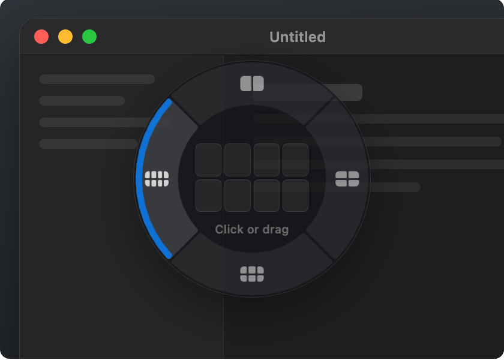
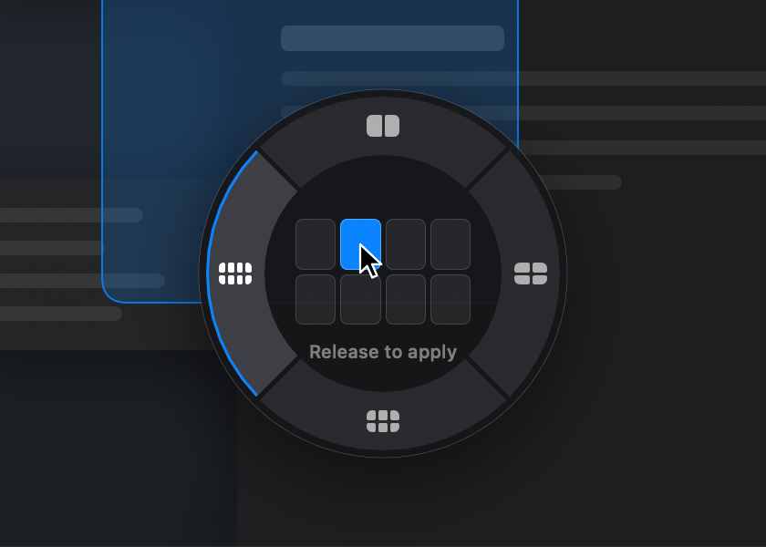
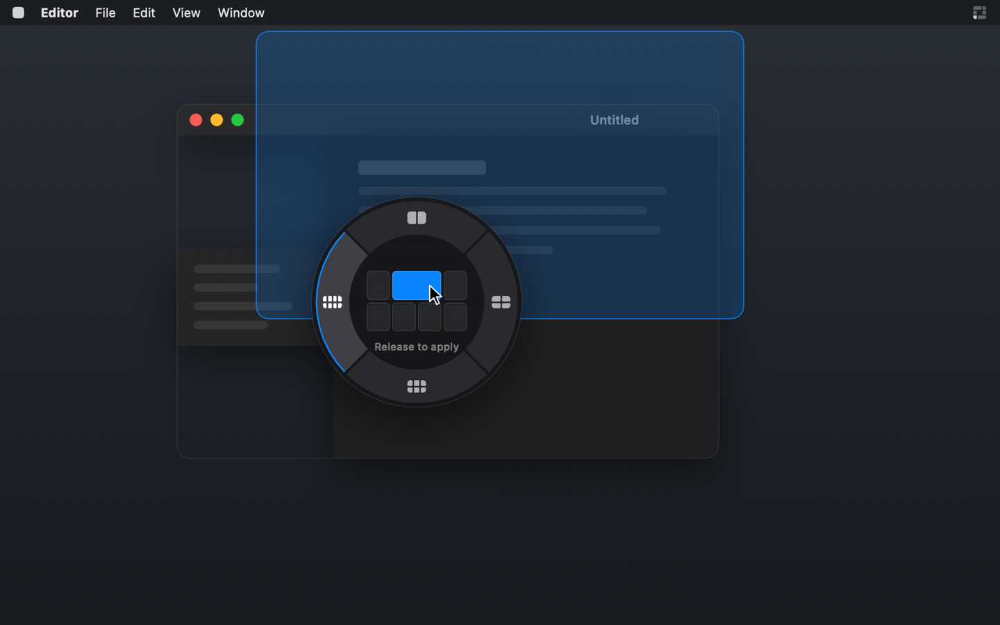

<p align="center">
  
</p>

<h1 align="center">Orbitile</h1>

<p align="center">
  Tile any window on macOS with one click of the middle mouse button.<br>
  A radial menu opens at your cursor, you pick a layout, and the window snaps into place.
</p>

<p align="center">
  
</p>

> The images are rendered by the app's own SwiftUI views over a mock desktop, so they match what the app draws. Regenerate them with `swift run Orbitile --scenes <folder>`. The backdrop blur and the real window movement are not part of those renders.

## What it does

Hover a window, click the middle button, and a ring of five layouts opens around the cursor. Move to a layout, pick a cell on the mini screen, and the window moves there. A blue preview shows the exact destination on your real screen before you commit.

| Open | Click a cell | Drag to merge | Preview on screen |
| :---: | :---: | :---: | :---: |
|  |  |  |  |
| Hover a family on the ring | Press a cell, release to apply | Drag across cells and release | The real target, before you commit |

### Layouts

The ring has five equal slices, starting at 12 o'clock and going clockwise.

| Family | Cells | Grid | Position on the ring | Key |
| :---: | :---: | :---: | :---: | :---: |
| 2 | 2 | 2 × 1 | 12 o'clock | `2` |
| 4 | 4 | 2 × 2 | about 2 o'clock | `4` |
| 6 | 6 | 3 × 2 | about 5 o'clock | `6` |
| 8 | 8 | 4 × 2 | about 7 o'clock | `8` |
| 10 | 10 | 5 × 2 | about 10 o'clock | `0` |

## Requirements

- macOS 14 (Sonoma) or newer
- A mouse with a middle button (a clickable scroll wheel)
- Swift 5.9+ toolchain (Xcode 15+ or the Command Line Tools) to build from source
- Accessibility permission, and possibly Input Monitoring

## Install

### Download

1. Get `Orbitile-x.y.z.dmg` from the [Releases page](https://github.com/jlucasgaspar/orbitile/releases) and open it. (There is also a `.zip` with the same app.)
2. Drag **Orbitile** onto the **Applications** shortcut in the window, then open it from `/Applications`.
3. If macOS says it cannot verify the app (builds that are not notarized), right-click the app and choose **Open**, or run:

   ```sh
   xattr -dr com.apple.quarantine /Applications/Orbitile.app
   ```

4. Grant **Accessibility** access when asked: **System Settings → Privacy & Security → Accessibility**, then enable Orbitile. It starts working right away, no relaunch needed. macOS may also ask for **Input Monitoring**, used by the global event tap.

A small grid icon appears in the menu bar. From there you can pause Orbitile, start it at login, or quit.

### Build from source

```sh
git clone https://github.com/jlucasgaspar/orbitile.git
cd orbitile
scripts/build-app.sh      # creates dist/Orbitile.app
open dist/Orbitile.app
```

Or run it straight from the terminal with `swift run -c release Orbitile`. In that case the Accessibility permission goes to the terminal app you launched it from.

Builds are ad-hoc signed, and macOS ties the Accessibility grant to the signature. After rebuilding, you may need to remove Orbitile from the Accessibility list and add it again.

## How to use

1. Hover the window you want to move.
2. **Click the middle button once and release.** You do not need to hold it. The fan opens centered on the cursor, and slides to stay on screen near the edges.
3. Hover a layout on the ring, or press `2`, `4`, `6`, `8` or `0` (for the 10-cell layout).
4. Point at a cell on the mini screen. The blue preview shows where the window will go.
5. **Click a cell** to apply instantly, or **press and drag across several cells** and release to merge them into one area.

### Controls

| Action | How |
| --- | --- |
| Open | Middle click on a window |
| Switch layout | Hover the ring, or press `2` `4` `6` `8` `0` |
| Apply to one cell | Left click the cell, or middle click while hovering it |
| Merge cells | Press on a cell, drag over others, release |
| Cancel | `Esc`, click outside the disc, or middle click with no cell hovered |

Releasing a drag outside the cells only clears the selection and keeps the fan open. If there is no movable window under the cursor, the middle click passes through to the app untouched.

## Troubleshooting

- **Nothing happens on middle click.** Accessibility is not granted for the process that launched Orbitile. Grant it and relaunch.
- **The fan opens but the window does not move.** Some apps (non-standard windows, some full screen or Electron windows) do not expose a movable window through Accessibility.
- **The blur behind the disc looks flat.** Check that *Reduce transparency* is off in System Settings → Accessibility → Display.

## Project layout

| Path | What is in it |
| --- | --- |
| `Sources/OrbitileCore` | Pure geometry and hover state: families, hit testing, target frames, easing |
| `Sources/Orbitile` | The app: event tap, Accessibility capture and move, overlay panel, SwiftUI fan |
| `Sources/OrbitileChecks` | Assertions for the core. Run with `swift run OrbitileChecks` |
| `design/` | The design project exported from Claude Design (reference only) |
| `docs/images/` | Logo and images used by this README |
| `scripts/` | `build-app.sh` (the `.app`), `release.sh` (styled `.dmg`, `.zip`, checksums, notarization), `dmg-settings.py` (installer window layout), `make-icon.sh` (the `.icns`) |

## Roadmap

What is left (multi-monitor testing, preferences, notarized builds and more) is tracked in [spec.md](spec.md).

## License

Orbitile is released under the [MIT License](LICENSE).
